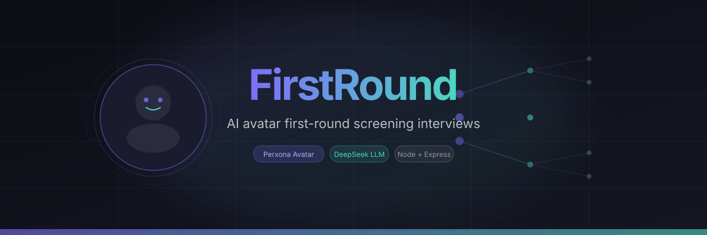
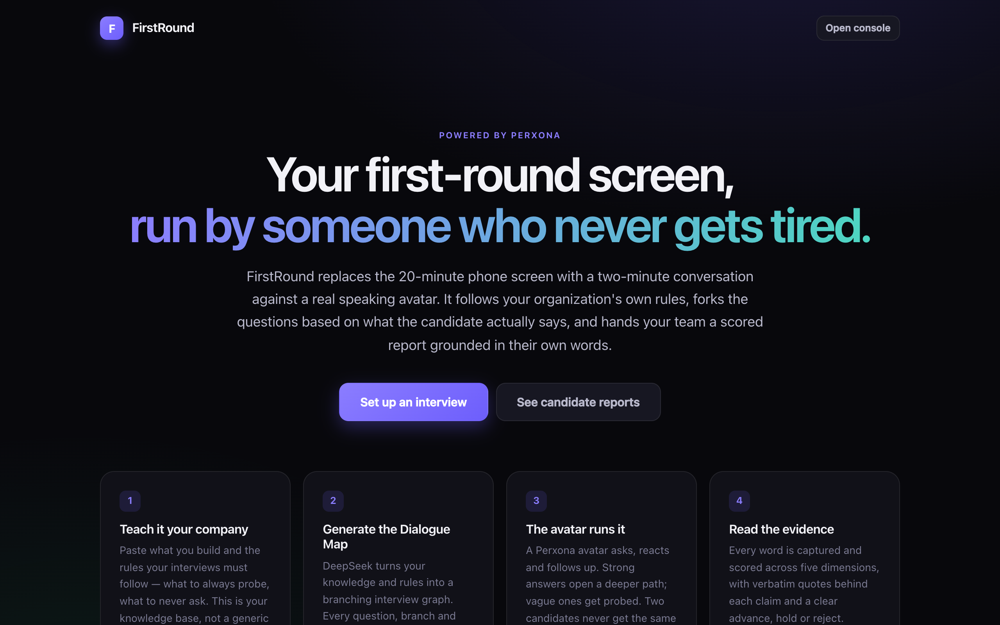
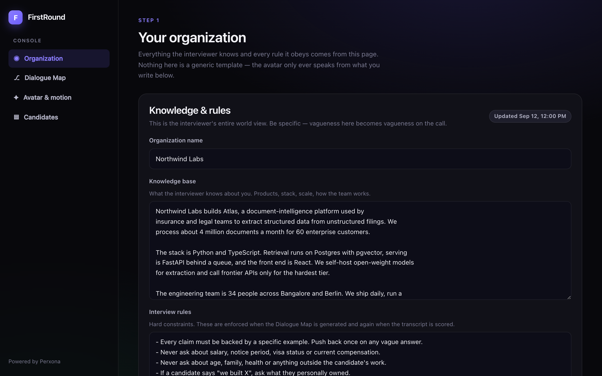
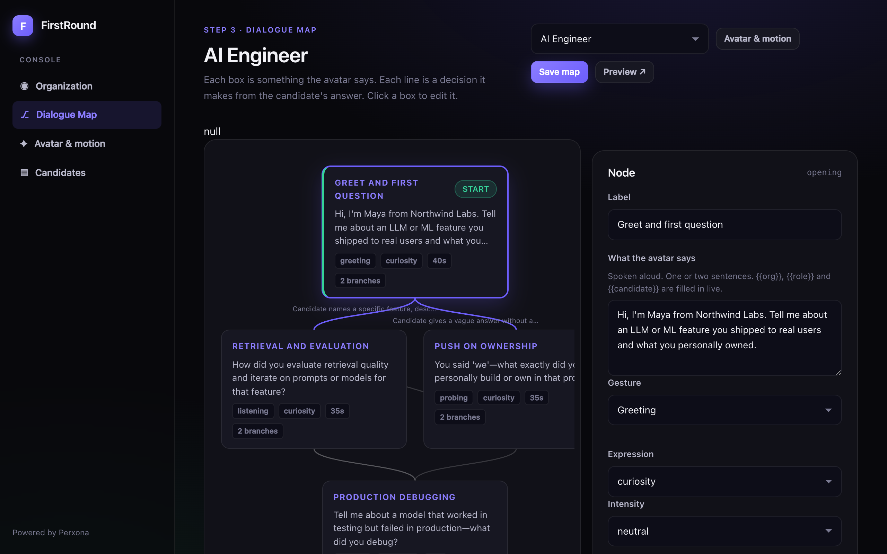
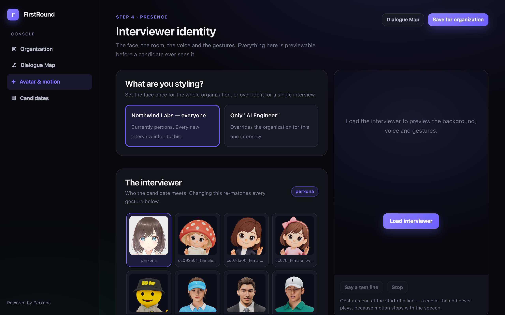
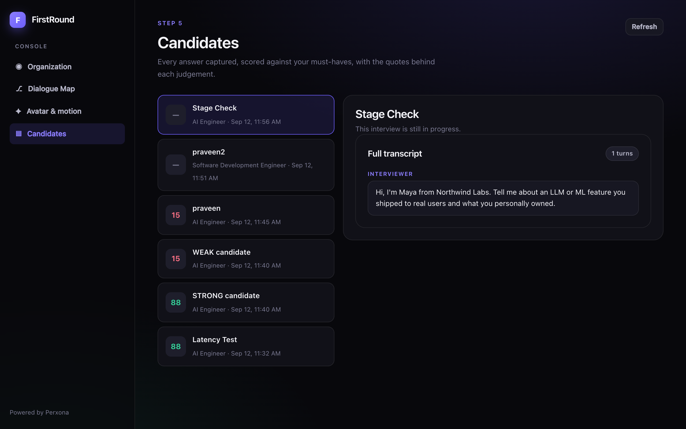

<div align="center">
  
</div>

<br/>

**FirstRound** replaces the manual first-round phone screen with a live AI avatar that asks follow-up questions based on what candidates actually say — then scores the transcript and hands you a report.

Built on the [Perxona Connect Kit](https://github.com/XRSPACE-Inc/perxona-connect-kit) (Hackvatar 2026 submission).

---

## Screenshots

| Home | Organization |
|------|-------------|
|  |  |

| Dialogue Map Editor | Avatar & Motion |
|--------------------|----------------|
|  |  |

| Candidate Reports |
|-------------------|
|  |

---

## How to run

```bash
# 1 — Install
npm install

# 2 — Configure
cp .env.example .env
# Fill in PERXONA_CONNECT_SECRET_KEY, PERXONA_CONNECT_PUBLISHABLE_KEY, and LLM_API_KEY

# 3 — Start
npm run dev
# Open http://localhost:8084
```

**Optional:** seed a sample org with two ready-to-run interview flows:

```bash
npm run seed
```

Requires **Node ≥ 22**. All data lives in `data/` (JSON files, gitignored — committed files are never written by the app).

---

## What it does

| Step | Who | What |
|------|-----|------|
| 1 | Recruiter | Writes the company's knowledge base and interview rules |
| 2 | Recruiter | Picks a role preset → DeepSeek generates a branching Dialogue Map |
| 3 | Recruiter | Edits the map in the visual flow editor; sets avatar, scene & gestures |
| 4 | Candidate | Opens `/i/<flowId>` — no login needed — and speaks with the avatar |
| 5 | Recruiter | Reviews the scored report with verbatim candidate quotes |

---

## The five screens

| Screen | Path | Purpose |
|--------|------|---------|
| Dashboard | `/org/` | Knowledge base, rules, role generation |
| Flow editor | `/org/flow.html` | Visual branching Dialogue Map editor |
| Motion editor | `/org/motions.html` | Avatar, scene, voice & 8 gesture slots |
| Reviews | `/org/reviews.html` | Scored candidate reports + transcripts |
| Interview | `/i/<flowId>` | Candidate-facing (share this link) |

---

## Environment variables

| Variable | Required | Description |
|----------|----------|-------------|
| `PERXONA_API_BASE_URL` | Yes | e.g. `https://console.perxona.ai/asia` |
| `PERXONA_CONNECT_SECRET_KEY` | Yes | Server-side Perxona key |
| `PERXONA_CONNECT_PUBLISHABLE_KEY` | Yes | Browser-side Perxona key |
| `PRESENTER_URL` | Yes | CDN URL — **must match the same region as API base** |
| `LLM_API_KEY` | Yes | DeepSeek (or any OpenAI-compatible) key |
| `LLM_BASE_URL` | No | Defaults to `https://api.deepseek.com/v1` |
| `LLM_MODEL` | No | Fast routing model. Default: `deepseek-flash` |
| `LLM_MODEL_QUALITY` | No | Slower generation/scoring model. Default: same as `LLM_MODEL` |
| `PORT` | No | Default: `8084` |

> **Region mismatch warning:** `PERXONA_API_BASE_URL` and `PRESENTER_URL` must name the same region. A mismatch looks configured but silently never loads the avatar.

---

## Why the avatar matters

A form gets copy-pasted CV bullets. A face gets an interview. Candidates speaking to a person — even a synthetic one — answer in their own words under real time pressure. The avatar's visible reaction to a thin answer is information the candidate can read and respond to. Remove the face and this is a questionnaire that tells you nothing a résumé didn't.

The Perxona avatar carries:
- **Emotion + intensity** per node (`curiosity`, `caring`, `realization`, …)
- **Motion markup** inline in the utterance (`[MOTION id:1] That's interesting…`)
- **8 named gesture slots** (`greeting`, `probing`, `skeptical`, `impressed`, …) so the whole map changes personality with one click

---

## Architecture

```
server.mjs              Express API + static host (port 8084)
lib/
  dml.mjs               Dialogue Map Language — routing, motion markup, reactions
  generate.mjs          org knowledge + rules → branching Dialogue Map (LLM)
  score.mjs             transcript → scored report (LLM)
  perxona.mjs           Perxona Connect catalog client
  llm.mjs               OpenAI-compatible chat client
  presets.mjs           role presets, gesture personalities, sample org
  store.mjs             JSON document store
public/
  js/presenter.js       Perxona avatar boot + present()
  js/interview.js       candidate-facing interview page
  org/                  recruiter console (4 screens)
data/                   orgs.json · flows.json · sessions.json  (gitignored)
docs/                   banner, slides
```

---

## License

MIT
